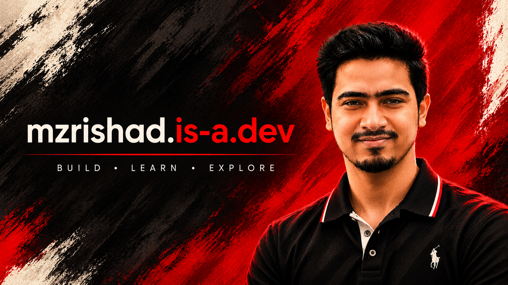
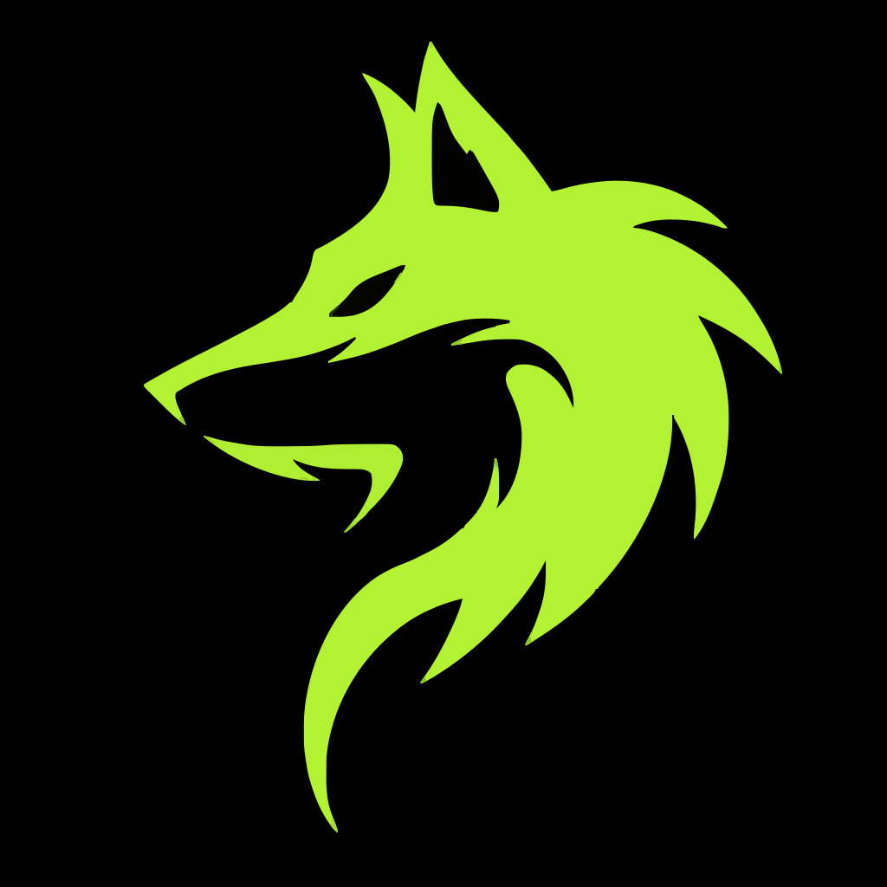
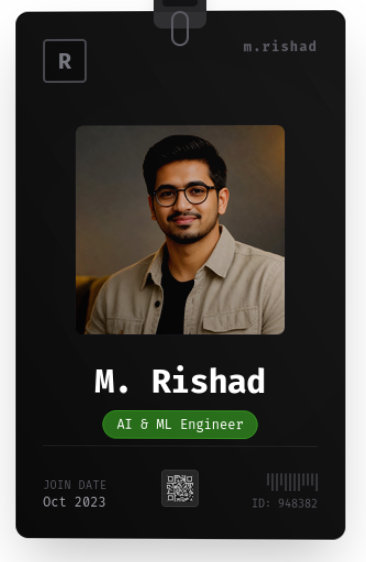

<div align="center">

  

  <br />

  

  <h1>Moniruzzaman Rishad — Interactive 3D OS & Terminal Portfolio</h1>

  <p>
    <strong>AI & Machine Learning Engineer &nbsp;·&nbsp; Full-Stack Systems Builder &nbsp;·&nbsp; Open Source Craftsman</strong>
  </p>

  <p>
    An interactive browser-based desktop environment combining a <strong>Linux GNOME Workspace</strong>, a toggleable <strong>Windows 11 Undercover Disguise</strong>, a <strong>3D Rapier Physics ID Badge</strong>, a full <strong>Unix Terminal Emulator</strong>, and a <strong>Google Gemini AI</strong> engineering assistant.
  </p>

  <p>
    <a href="https://mzrishad.is-a.dev" target="_blank">
      
    </a>
    <a href="https://mzrishad.netlify.app" target="_blank">
      
    </a>
    <a href="https://github.com/Solved-Overnight" target="_blank">
      
    </a>
    <a href="https://linkedin.com/in/mzrishad" target="_blank">
      
    </a>
    <a href="https://www.instagram.com/mzrishad/" target="_blank">
      
    </a>
  </p>

  <p>
    
    
    
    
    
    
    
    
  </p>

</div>

---

## Visual Preview

<div align="center">
  <table>
    <tr>
      <td width="50%" align="center" valign="top">
        <h3>3D Physics-Driven ID Badge</h3>
        
        <p><sub>Real-time Three.js &amp; Rapier rigid-body lanyard with spherical joints, glass sheen shading, QR/barcode canvas textures, and drag physics.</sub></p>
      </td>
      <td width="50%" align="center" valign="top">
        <h3>Dual-OS Workspace &amp; Terminal</h3>
        
        <p><sub>Split-pane GNOME &amp; Windows 11 desktop environments with Spotlight search, draggable/resizable windows, and an interactive Zsh shell.</sub></p>
      </td>
    </tr>
  </table>
</div>

---

## Architectural Highlights

<table>
  <tr>
    <td width="50%" valign="top">
      <h4>Dual Desktop Environment + Mobile Shell</h4>
      <ul>
        <li><strong>Linux GNOME Mode:</strong> Top bar, notification center, dock launcher, app grid, wallpaper picker, draggable/resizable split windows, and <code>⌘K</code> / <code>Ctrl+K</code> Spotlight search.</li>
        <li><strong>Windows 11 Undercover Mode:</strong> Morphs the entire workspace skin into a Fluent Windows 11 desktop (<code>undercover</code> command or menu toggle) while preserving open session states.</li>
        <li><strong>Animated Startup Sequence:</strong> Plays an authentic human-paced Spotlight launch on Linux or cursor-driven icon launch on Windows during initial page loads.</li>
        <li><strong>Responsive Mobile Experience:</strong> Dedicated mobile boot sequence, tab switcher, and Linux-styled terminal view.</li>
      </ul>
    </td>
    <td width="50%" valign="top">
      <h4>3D Kinetic Lanyard &amp; AI Shell</h4>
      <ul>
        <li><strong>Rapier 3D Physics:</strong> Multi-segment rope and spherical joints with realistic inertia, angular damping, and interactive pointer dragging.</li>
        <li><strong>Unix Terminal Emulator:</strong> Supports virtual POSIX commands (<code>ls</code>, <code>cd</code>, <code>pwd</code>, <code>cat</code>), portfolio commands (<code>about</code>, <code>projects</code>, <code>skills</code>, <code>experience</code>, <code>blogs</code>), tab autocomplete, and persistent history.</li>
        <li><strong>Gemini AI Integration:</strong> Server-side <code>/api/chat</code> proxy (Express) + Netlify serverless fallback powered by <code>@google/genai</code> with automatic model fallback and first-person technical Q&amp;A.</li>
        <li><strong>Markdown Research Blogs:</strong> Built-in Thunar-style blog explorer and rich Markdown reader backed by <code>blogs/*.md</code> frontmatter.</li>
      </ul>
    </td>
  </tr>
</table>

---

## Theme Engine

The live theme engine updates terminal ANSI styling, window chrome, CSS custom properties, and 3D badge accents simultaneously—alongside a custom color editor.

| Theme | Command Identifier | Primary Accent | Profile |
| :--- | :--- | :---: | :--- |
| **Matrix** | `default` | `#4af626` | Neon hacker green on deep obsidian |
| **Linux Official** | `kali` | `#1f6feb` | Electric blue & cyber cyan workstation palette |
| **Linux Undercover** | `undercover` | `#0078d4` | Windows 11 Fluent blue workspace skin |
| **Cyberpunk** | `cyberpunk` | `#00f0ff` | High-contrast neon cyan & night-city accents |
| **Dracula** | `dracula` | `#ff79c6` | Classic dark purple & magenta developer palette |
| **Tokyo Night** | `tokyonight` | `#7aa2f7` | Midnight indigo & soft neon highlights |
| **Monokai Pro** | `monokai` | `#a6e22e` | Warm charcoal with vivid lime & amber tones |
| **Nord Arctic** | `nord` | `#88c0d0` | Crisp frost-blue minimalist aesthetic |
| **Catppuccin** | `catppuccin` | `#cba6f7` | Soothing pastel mocha surface palette |

> *19 curated presets plus a live custom theme builder (`theme <name>` in terminal or via **System Settings**).*

---

## Terminal Command Reference

| Command | Arguments | Description |
| :--- | :--- | :--- |
| `help` | — | Display all available commands, shortcuts, and usage hints |
| `about` | — | Summary of engineering background and production ML impact |
| `projects` | — | Launch or inspect AI/ML, Computer Vision, and MLOps projects |
| `skills` | — | Categorized technical matrix (AI/ML, Backend, Data, DevOps) |
| `experience` | — | Career history, engineering roles, and measurable outcomes |
| `blogs` | `[number \| slug]` | Open the research blog browser or read an article inline |
| `ai` | `<prompt>` | Ask the Gemini-powered assistant about Rishad's work |
| `theme` | `[theme_name]` | List available themes or switch the active palette |
| `undercover` | — | Toggle between Linux GNOME and Windows 11 desktop modes |
| `neofetch` | — | Render system specs, OS theme, and session summary |
| `ls` / `cd` / `cat` / `pwd` | `[path]` | Navigate and inspect the virtual Unix filesystem |
| `contact` | — | Show direct email, GitHub, LinkedIn, Instagram, and WhatsApp |
| `clear` | — | Clear the active terminal output buffer |

---

## Project Structure

```text
├── App.tsx                  # Root OS orchestrator (Boot, Lock, Desktop, Mobile routing)
├── server.ts                # Express 5 server + Vite middleware + /api/chat & /api/blogs
├── constants.ts             # Portfolio profile data, projects, skills, virtual FS
├── blogs/                   # Markdown research papers & industry analysis posts
├── components/
│   ├── LinuxGnomeDesktop.tsx# GNOME desktop, dock, Spotlight search & split windows
│   ├── Windows11Desktop.tsx # Undercover Windows 11 desktop, Start menu & taskbar
│   ├── Terminal.tsx         # Interactive shell, virtual FS & Gemini AI query handler
│   ├── IdCard.tsx           # Three.js + Rapier 3D physics lanyard & dynamic badge
│   ├── BlogModal.tsx        # Thunar-inspired blog explorer & Markdown reader
│   ├── ProjectsModal.tsx    # Interactive project showcase deck
│   └── BootScreen.tsx       # Linux & Windows startup splash sequences
├── contexts/
│   └── ThemeContext.tsx     # Persistent theme provider & CSS variable synchronization
├── netlify/functions/       # Serverless /api/chat and /api/blogs handlers for Netlify
├── public/img/              # Wallpapers, SEO preview cards & public static assets
└── utils/                   # Blog parser, theme presets, audio FX & notifications
```

---

## Getting Started

### Prerequisites

- **Node.js** `>= 20.x`
- **npm** (or compatible package manager)
- A **Google Gemini API Key** (for live `ai` terminal responses)

### 1. Install Dependencies

```bash
git clone https://github.com/Solved-Overnight/terminal_portfolio.git
cd terminal_portfolio
npm install
```

### 2. Configure Environment Variables

Copy `.env.example` to `.env` and populate your API key:

```bash
cp .env.example .env
```

```env
# Server-side proxy (Express / Netlify Functions)
GEMINI_API_KEY=your_gemini_api_key_here

# Optional client-side fallback key
VITE_API_KEY=

# Optional Google Analytics 4 & Search Console verification
VITE_GA_MEASUREMENT_ID=G-0SV0LZVY0P
VITE_GOOGLE_SITE_VERIFICATION=
```

### 3. Run Locally

Starts the Express backend and Vite dev server together on `http://localhost:3000`:

```bash
npm run dev
```

### 4. Production Build & Verification

```bash
# Type-check TypeScript
npm run lint

# Build frontend (dist/) and bundle server (dist/server.cjs)
npm run build

# Start production Node server
npm start
```

> **Netlify Deployment:** `netlify.toml` is preconfigured to build `dist/`, package `blogs/**` with `netlify/functions/`, and route `/api/chat` and `/api/blogs` automatically.

---

<div align="center">

  ### Connect & Collaborate

  <a href="mailto:mzrishad.info@gmail.com">
    
  </a>
  &nbsp;
  <a href="https://linkedin.com/in/mzrishad" target="_blank">
    
  </a>
  &nbsp;
  <a href="https://www.instagram.com/mzrishad/" target="_blank">
    
  </a>
  &nbsp;
  <a href="https://mzrishad.is-a.dev" target="_blank">
    
  </a>

  <br /><br />

  <sub>Engineered by <strong>Moniruzzaman Rishad</strong> (<a href="https://github.com/Solved-Overnight">@Solved-Overnight</a>)</sub>

</div>
