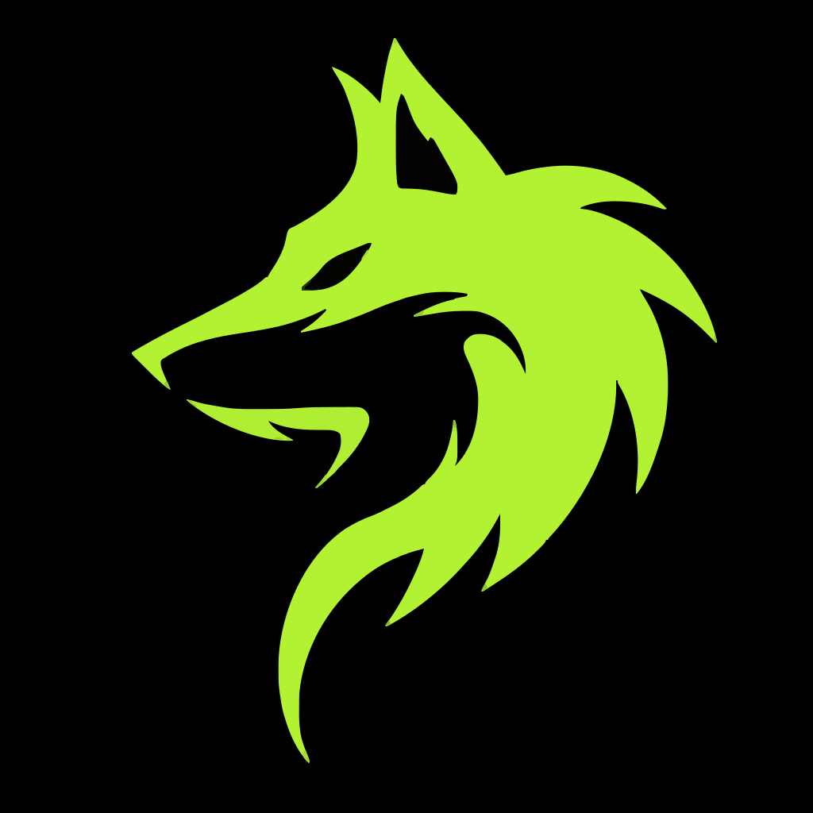
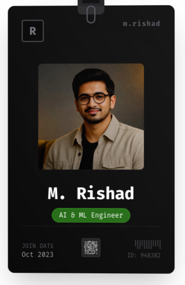

  

  # ⚡ Moniruzzaman Rishad | Interactive 3D Terminal Portfolio
  
  

    <strong>AI & Machine Learning Engineer • Full-Stack Developer • Open Source Craftsman</strong>
  

  

    
    
    
    
  

  

    
    
    
    
    
    
    
  

---

## 📸 Showcase & Visual Experience

  <table>
    <tr>
      <td width="50%" align="center">
        <h3>🪪 Physics-Driven 3D ID Card</h3>
        
        
<em>Interactive lanyard with realistic spherical joints, spring physics, dynamic QR generation & drag interactions.</em>

      </td>
      <td width="50%" align="center">
        <h3>💻 Cyberpunk Linux Terminal</h3>
        
        
<em>Authentic CLI interface featuring virtual Unix filesystem, multi-theme engine & Google Gemini AI queries.</em>

      </td>
    </tr>
  </table>

---

## 🌟 Key Highlights

<table>
  <tr>
    <td width="33%" valign="top">
      <h4>🪪 3D Kinetic Lanyard</h4>
      <ul>
        <li>Real-time rigid body dynamics simulated with <strong>Rapier Physics</strong>.</li>
        <li>Rope & spherical joints with inertia, damping, and kinetic drag.</li>
        <li>Dynamic canvas texture rendering sharp QR codes, barcodes, and microchip gold contacts.</li>
      </ul>
    </td>
    <td width="33%" valign="top">
      <h4>🖥️ Unix Terminal Emulator</h4>
      <ul>
        <li>Realistic virtual shell supporting standard POSIX navigation: <code>ls</code>, <code>cd</code>, <code>pwd</code>, <code>cat</code>.</li>
        <li>Interactive resume commands: <code>about</code>, <code>projects</code>, <code>skills</code>, <code>experience</code>.</li>
        <li>Tab autocompletion, persistent command history, and retro boot sequences.</li>
      </ul>
    </td>
    <td width="33%" valign="top">
      <h4>🤖 Integrated Gemini AI</h4>
      <ul>
        <li>Direct integration with <strong>Google Gemini 3.6 Flash</strong>.</li>
        <li>Natural language conversations answering technical questions about experience and projects.</li>
        <li>Fallback client architecture supporting both full-stack server proxy and Netlify SPA builds.</li>
      </ul>
    </td>
  </tr>
</table>

---

## 🎨 Theme Engine

The application features a built-in multi-theme switcher that adapts both the terminal typography and the 3D ID card materials in real time:

| Theme | Identifier | Accent Color | Aesthetic |
| :--- | :--- | :---: | :--- |
| **Matrix** | `default` | <code>#4af626</code> | Iconic neon hacker green on deep obsidian |
| **Cyberpunk** | `cyberpunk` | <code>#00f0ff</code> | High-contrast neon cyan & magenta night-city vibe |
| **Dracula** | `dracula` | <code>#bd93f9</code> | Elegant dark gothic theme with vampire purple accents |
| **Monokai** | `monokai` | <code>#a6e22e</code> | Classic code editor palette with vivid lime highlights |
| **Tokyo Night** | `tokyonight` | <code>#7aa2f7</code> | Modern Tokyo metropolis midnight blue atmosphere |
| **Nord** | `nord` | <code>#88c0d0</code> | Arctic, north-bluish clean minimalist aesthetic |
| **Catppuccin** | `catppuccin` | <code>#cba6f7</code> | Soothing pastel palette with mocha undertones |

> 💡 *Switch themes anytime in the terminal by typing: `theme <name>` (e.g. `theme cyberpunk`)*

---

## ⌨️ Terminal Command Reference

  <table>
    <thead>
      <tr>
        <th align="left">Command</th>
        <th align="left">Arguments</th>
        <th align="left">Description</th>
      </tr>
    </thead>
    <tbody>
      <tr>
        <td><code>help</code></td>
        <td><em>none</em></td>
        <td>Display all available system commands and shortcuts</td>
      </tr>
      <tr>
        <td><code>about</code></td>
        <td><em>none</em></td>
        <td>Display professional summary, background, and research focus</td>
      </tr>
      <tr>
        <td><code>projects</code></td>
        <td><em>none</em></td>
        <td>Browse production ML platforms, agentic workflows, and CV applications</td>
      </tr>
      <tr>
        <td><code>skills</code></td>
        <td><em>none</em></td>
        <td>View technical competencies categorized by AI/ML, Backend, and DevOps</td>
      </tr>
      <tr>
        <td><code>experience</code></td>
        <td><em>none</em></td>
        <td>Review professional career trajectory, industry outcomes, and roles</td>
      </tr>
      <tr>
        <td><code>blogs</code></td>
        <td><em>none</em></td>
        <td>Read technical write-ups and engineering articles</td>
      </tr>
      <tr>
        <td><code>contact</code></td>
        <td><em>none</em></td>
        <td>Get direct contact channels (Email, GitHub, LinkedIn, Website)</td>
      </tr>
      <tr>
        <td><code>theme</code></td>
        <td><code>[theme_name]</code></td>
        <td>List available color schemes or switch active palette</td>
      </tr>
      <tr>
        <td><code>ls</code></td>
        <td><code>[path]</code></td>
        <td>List contents and directory hierarchy of the virtual file system</td>
      </tr>
      <tr>
        <td><code>cd</code></td>
        <td><code>[directory]</code></td>
        <td>Change active virtual working directory</td>
      </tr>
      <tr>
        <td><code>cat</code></td>
        <td><code>[file]</code></td>
        <td>Display the content of a file</td>
      </tr>
      <tr>
        <td><code>pwd</code></td>
        <td><em>none</em></td>
        <td>Print the current working directory path</td>
      </tr>
      <tr>
        <td><code>clear</code></td>
        <td><em>none</em></td>
        <td>Clear output history on the active terminal viewport</td>
      </tr>
      <tr>
        <td><code>ai</code></td>
        <td><code>[prompt]</code></td>
        <td>Ask the Gemini AI assistant anything about Rishad's work</td>
      </tr>
    </tbody>
  </table>

---

## 🛠️ Architecture & Core Technologies

  <table>
    <tr>
      <td align="center" width="25%">
         
        <strong>React 19 & Fiber</strong> 
        Declarative 3D Canvas & UI components
      </td>
      <td align="center" width="25%">
         
        <strong>Three.js & Rapier</strong> 
        High-performance WebGL & 3D Rigid Body Physics
      </td>
      <td align="center" width="25%">
         
        <strong>TypeScript 5</strong> 
        Strict type-safe terminal commands & state management
      </td>
      <td align="center" width="25%">
         
        <strong>Tailwind CSS</strong> 
        Responsive cyberpunk styling & glassmorphic panels
      </td>
    </tr>
  </table>

---

  ### 📬 Connect & Collaborate

  
  &nbsp;
  
  &nbsp;
  

    
  
  

    Crafted with passion, physics & pixels by <strong>Moniruzzaman Rishad</strong> (@Solved-Overnight)
  

